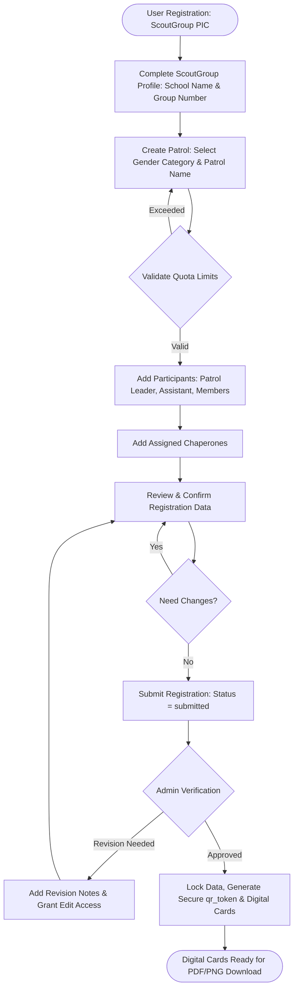
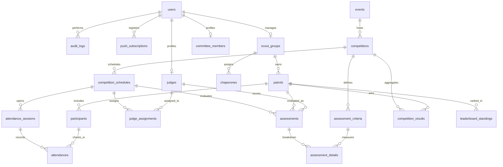

# System Architecture & Design Document: LT III Kwarcab Padangsidimpuan
**Phase 0 — Requirements Analysis, Technical Architecture, and System Design**

---

## 1. Application Requirements Summary

The **LT III Kwarcab Padangsidimpuan** web application (*Lomba Tingkat III Kwartir Cabang Gerakan Pramuka Kota Padangsidimpuan*) is built as an integrated Progressive Web App (PWA) using **Laravel 13**, **Livewire 4**, **Flux UI**, **Tailwind CSS**, and **MariaDB**.

Core operational objectives:
- **Registration Management:** Hierarchical structure from `ScoutGroup` &rarr; `Patrol` (Boys / Girls) &rarr; `Participant` (`patrol_leader`, `assistant_patrol_leader`, `member`) and `Chaperone`.
- **Digital Accreditation & Identity Cards:** Issuance of digital credential cards embedding secure, encrypted/random UUID `qr_token` strings (no raw personally identifiable information / PII exposed).
- **Anti-Fraud QR Attendance Verification:** Server-time clamped attendance checking (`Asia/Jakarta` WIB, window open at $H-30$ minutes before schedule start), dual camera support (front/rear), prevention of duplicate check-ins, and full audit logging per scan action.
- **Dynamic & Blind Scoring Engine:** Flexible rubric criteria, customizable scoring scales and weights per competition, status lifecycle (`draft` &rarr; `submitted` &rarr; `finalized`), with backend identity masking (*blind scoring*) to prevent judge bias.
- **Real-Time Standings (Live Rank):** Automatic medal-based ranking hierarchy:
  1. `highest_achievement` (Prestasi Tinggi / 1st Place)
  2. `good_achievement` (Prestasi Baik / 2nd Place)
  3. `fair_achievement` (Prestasi Cukup / 3rd Place)
  Broadcasted dynamically to clients via **Laravel Reverb** WebSockets.
- **PWA & Web Push Notification:** Mobile-first responsive layout, offline fallback service worker for outdoor camp areas, and targeted Web Push API (VAPID) schedule reminders.

---

## 2. Actors & Role-Based Access Control (RBAC) Matrix

System actors:
1. `Admin` (Super Admin / Steering Committee): Full control over settings, master data, RBAC, registration verification & approval, QR attendance scanning execution, score overrides, and audit trails.
2. `CommitteeMember` (Panitia): Operational monitoring of field activities (read-only view of dashboards, schedules, live attendance overview, and operational reports). Does NOT verify registrations and does NOT execute attendance scanning.
3. `Judge` (Juri): Review assigned competitions, verify participant check-in attendance at assigned competition pos, input and finalize scores.
4. `CommitteeMember` + `Judge` (Dual Role): Unified account with committee operational monitoring privileges plus active scoring and attendance scanning capabilities exclusively on assigned competitions.
5. `ScoutGroup` / `Chaperone` (Gugus Depan PIC): Management of school contingent (register patrols, members, chaperones, download digital identity cards).
6. `Participant` (Peserta / Regu): View squad digital cards, scheduled matches, attendance status, and published results.
7. `Guest` / Public: Public landing page, general competition guidelines, schedules, and officially published leaderboard.

### RBAC Permission Matrix

| Feature / Resource | Route URL / Permission | Admin | Committee | Judge | Committee + Judge | Scout Group | Participant | Guest |
|---|---|:---:|:---:|:---:|:---:|:---:|:---:|:---:|
| System Settings | `/admin/settings` | CRUD | - | - | - | - | - | - |
| User & Role Management | `/admin/users` | CRUD | - | - | - | - | - | - |
| Scout Groups & Patrols Verification | `/admin/scout-groups` | Verify & Approve | View Only | - | View Only | Input/Edit Own | View Own | - |
| Participants & Chaperones Verification | `/admin/participants` | Verify & Approve | View Only | - | View Only | Input/Edit Own | View Own | - |
| Digital ID Cards & QR Generation | `/digital-cards/{token}` | All | View Only | Own | Own | Own Group | Own ID | - |
| Schedule & Rubrics | `/admin/schedules` | CRUD | View Only | View | View | View | View | Public View |
| Scanner: Participant Attendance | `/attendance/scanner` | Yes (Execute) | View Only | Assigned Pos | Assigned Pos | - | - | - |
| Scanner: Staff Attendance | `/attendance/staff-scanner` | Yes (Execute) | View Only | - | - | - | - | - |
| Daily Chaperone Attendance | `/attendance/chaperones` | Yes (Execute) | View Only | - | - | View Status | - | - |
| Live Attendance Monitor | `/portal/attendance/monitor` | Yes | Yes (Monitor) | Assigned | Yes (Monitor) | - | - | - |
| Score Input (Draft) | `/assessments/{scheduleId}` | Override | - | Assigned | Assigned | - | - | - |
| Score Finalization | `/assessments/{id}/finalize`| Override | - | Assigned | Assigned | - | - | - |
| Score Lock Correction | `/admin/audit-logs/score` | Yes | - | Request | Request | - | - | - |
| Unmasked Internal Leaderboard | `/admin/leaderboard/internal`| Yes | Yes (Monitor)| Assigned | Assigned | - | - | - |
| Official Public Live Rank | `/leaderboard` | Yes | Yes | Yes | Yes | Yes | Yes | Yes |
| Web Push Broadcast | `/admin/announcements/broadcast` | Yes | View Only | - | - | - | - | - |
| Export Reports (PDF/Excel) | `/reports/export` | Full | View Only | - | View Only | - | - | - |

---

## 3. Registration Flow Diagram (`ScoutGroup` to `Participant`)



---

## 4. Attendance & Assessment Flow Diagram

```mermaid
flowchart TD
    subgraph Attendance_Scanning_Workflow [Attendance Verification]
        OpenScanner[Admin / Judge Opens Camera QR Scanner] --> ReadToken[Decode qr_token via WebRTC Camera]
        ReadToken --> ValidateServerTime{Check Server Time WIB: Open H-30 min to Cutoff?}
        ValidateServerTime -- Not in Window --> RejectTime[Reject: Schedule Attendance Not Open / Expired]
        ValidateServerTime -- Valid --> CheckAssignment{Check Registered for this Competition Schedule?}
        CheckAssignment -- Not Registered --> RejectPos[Reject: Wrong Post / Not Enrolled]
        CheckAssignment -- Registered --> CheckDuplicate{Check Duplicate in attendance_sessions?}
        CheckDuplicate -- Already Present --> RejectDuplicate[Reject: Duplicate Check-In Detected]
        CheckDuplicate -- Not Yet Present --> RecordAttendance[Store via DB Transaction: server_time, scanner_id, status=present]
        RecordAttendance --> AttendanceSuccess([Attendance Status: Present])
    end

    subgraph Scoring_Workflow [Scoring Engine & Blind Assessment]
        JudgeLogin[Judge Accesses Assigned Competition Schedule] --> CheckJudgeCheckIn{Judge Checked In for Session?}
        CheckJudgeCheckIn -- No --> RequireCheckIn[Warning: Judge Must Check In First]
        CheckJudgeCheckIn -- Yes --> LoadRubric[Load Rubric Criteria & Min/Max Score Ranges]
        LoadRubric --> BackendMasking[Backend Masking: Replace Real Names with Anonymous Draw Numbers]
        BackendMasking --> InputScores[Judge Inputs Score Breakdown & Notes]
        InputScores --> SaveDraft[Save Draft: assessment_status = draft]
        SaveDraft --> FinalizeConfirm{Confirm Score Finalization?}
        FinalizeConfirm -- Later --> SaveDraft
        FinalizeConfirm -- Yes --> LockScore[Validate Bounds, Lock Score: assessment_status = finalized]
        LockScore --> CommitteeAudit{Admin / Steering Committee Review}
        CommitteeAudit -- Correction Needed --> ScoreCorrection[Unlock with Required Reason & Audit Trail]
        CommitteeAudit -- Approved --> PublishResults[Publish Results & Reverb WebSocket Broadcast]
    end
```



---

## 5. Initial ERD & Database Schema Specification



### English Table Schema & Model Definitions

#### 1. Identity & RBAC
- **`users`**: `id`, `name`, `email`, `password`, `phone_number`, `avatar_path`, `is_active`, `email_verified_at`, `created_at`, `updated_at`.
- **`roles`**, **`permissions`**, **`model_has_roles`**: Spatie RBAC integration.
- **`audit_logs`**: `id`, `user_id`, `action`, `model_type`, `model_id`, `old_values` (JSON), `new_values` (JSON), `ip_address`, `user_agent`, `created_at`.
- **`push_subscriptions`**: `id`, `user_id`, `endpoint`, `public_key`, `auth_token`, `content_encoding`, `device_label`, `created_at`, `updated_at`.

#### 2. Contingent & Accreditation
- **`scout_groups`**: `id`, `user_id`, `registration_code`, `school_name`, `group_number` (Nomor Gudep), `address`, `contact_person`, `contact_phone`, `verification_status` (`draft`, `submitted`, `verified`, `needs_revision`, `rejected`), `verified_by`, `verified_at`, `created_at`, `updated_at`.
- **`patrols`**: `id`, `scout_group_id`, `patrol_name`, `gender_category` (`boys`, `girls`), `status` (`draft`, `active`, `disqualified`), `created_at`, `updated_at`.
- **`participants`**: `id`, `patrol_id`, `full_name`, `national_student_id` (NISN), `scout_id` (KTA Pramuka), `role_in_patrol` (`patrol_leader`, `assistant_patrol_leader`, `member`), `gender`, `birth_date`, `birth_place`, `blood_type`, `photo_path`, `qr_token` (UUIDv4 unique index), `qr_generated_at`, `status` (`pending`, `active`), `created_at`, `updated_at`.
- **`chaperones`**: `id`, `scout_group_id`, `user_id` (nullable), `full_name`, `scout_id`, `national_identity_number` (NIK), `gender`, `phone_number`, `photo_path`, `qr_token` (UUIDv4 unique index), `status`, `created_at`, `updated_at`.
- **`committee_members`**: `id`, `user_id`, `full_name`, `division`, `position`, `phone_number`, `photo_path`, `qr_token`, `status`, `created_at`, `updated_at`.
- **`judges`**: `id`, `user_id`, `full_name`, `scout_rank`, `specialization`, `phone_number`, `photo_path`, `qr_token`, `status`, `created_at`, `updated_at`.

#### 3. Competitions, Schedules & Attendance
- **`events`**: `id`, `title`, `theme`, `start_date`, `end_date`, `location`, `is_active`, `created_at`, `updated_at`.
- **`competitions`**: `id`, `event_id`, `code`, `title`, `description`, `target_category` (`boys`, `girls`, `mixed`), `participant_type` (`patrol`, `individual`), `guidelines_pdf_path`, `scoring_formula` (`average`, `sum`, `trimmed_mean`), `is_published`, `created_at`, `updated_at`.
- **`assessment_criteria`**: `id`, `competition_id`, `name`, `code`, `description`, `min_score`, `max_score`, `weight_percentage`, `order_index`, `created_at`, `updated_at`.
- **`competition_schedules`**: `id`, `competition_id`, `session_name`, `arena_location`, `start_time` (DATETIME), `end_time` (DATETIME), `checkin_open_time` (DATETIME), `checkin_close_time` (DATETIME), `status` (`scheduled`, `in_progress`, `completed`, `rescheduled`, `cancelled`), `is_published`, `created_at`, `updated_at`.
- **`judge_assignments`**: `id`, `competition_schedule_id`, `judge_id`, `role` (`lead_judge`, `scoring_judge`, `companion_judge`), `is_confirmed`, `created_at`, `updated_at`.
- **`attendance_sessions`**: `id`, `competition_schedule_id`, `session_type` (`participant`, `judge`, `committee`, `chaperone`), `title`, `opened_at`, `closed_at`, `is_active`, `created_at`, `updated_at`.
- **`attendances`**: `id`, `attendance_session_id`, `participant_id` (nullable), `judge_id` (nullable), `committee_member_id` (nullable), `chaperone_id` (nullable), `scanned_by_user_id`, `scanned_at` (DATETIME server timestamp), `status` (`present`, `late`, `excused`, `absent`), `notes`, `device_info`, `created_at`, `updated_at`.

#### 4. Scoring & Leaderboard
- **`assessments`**: `id`, `competition_schedule_id`, `judge_id`, `patrol_id` (nullable), `participant_id` (nullable), `anonymous_code`, `total_score`, `status` (`draft`, `submitted`, `finalized`), `submitted_at`, `finalized_at`, `correction_reason`, `created_at`, `updated_at`.
- **`assessment_details`**: `id`, `assessment_id`, `assessment_criterion_id`, `raw_score`, `weighted_score`, `notes`, `created_at`, `updated_at`.
- **`competition_results`**: `id`, `competition_id`, `patrol_id`, `final_score`, `rank_position`, `achievement_tier` (`highest_achievement`, `good_achievement`, `fair_achievement`, `none`), `is_published`, `published_at`, `published_by`, `created_at`, `updated_at`.
- **`leaderboard_standings`**: `id`, `event_id`, `patrol_id`, `highest_achievement_count`, `good_achievement_count`, `fair_achievement_count`, `total_medals`, `rank_position`, `updated_at`.

---

## 6. Architecture & Business Rules

### A. Core Constants & Nomenclature
- **Official Title:** *Lomba Tingkat III Kwartir Cabang Gerakan Pramuka Kota Padangsidimpuan*
- **Short Name:** *LT III Kwarcab Padangsidimpuan*
- **Official Copyright Footer:** *© LT III Kwarcab Padangsidimpuan — Bagian Humas dan Informatika Kwartir Cabang Gerakan Pramuka Kota Padangsidimpuan.*
- **System Timezone:** `Asia/Jakarta` (WIB) enforced at application kernel level (`config/app.php`).
- **QR Token Specification:** `UUIDv4` generated string stored in database, rendered via SVG/Canvas. Never encode plain text PII.
- **Attendance Time Clamping:** Check-in window opens strictly at $T - 30\text{ min}$ based on the server clock.
- **Blind Scoring Protocol:** Controller and Livewire components strip `scout_group` and `patrol_name`, passing only randomized `anonymous_code` to judge view.
- **Achievement Tier Ranking Order:**
  1. `highest_achievement` (Prestasi Tinggi)
  2. `good_achievement` (Prestasi Baik)
  3. `fair_achievement` (Prestasi Cukup)

### B. Standardized English Routing Design

```
/
├── /login
├── /register
├── /forgot-password
├── /announcements
├── /competitions
├── /schedules
├── /leaderboard
│
├── /portal/scout-group
│   ├── /portal/scout-group/profile
│   ├── /portal/scout-group/patrols
│   ├── /portal/scout-group/participants
│   ├── /portal/scout-group/chaperones
│   ├── /portal/scout-group/registration-summary
│   └── /portal/scout-group/id-cards
│
├── /portal/judge
│   ├── /portal/judge/assignments
│   ├── /portal/judge/attendance
│   └── /portal/judge/assessments/{scheduleId}
│
├── /portal/attendance
│   ├── /portal/attendance/scanner
│   ├── /portal/attendance/manual-entry
│   └── /portal/attendance/logs
│
└── /admin
    ├── /admin/dashboard
    ├── /admin/settings
    ├── /admin/users
    ├── /admin/scout-groups
    ├── /admin/competitions
    ├── /admin/schedules
    ├── /admin/assessments
    ├── /admin/leaderboard
    ├── /admin/audit-logs
    └── /admin/reports
```

---

## 7. Technical Stack & Deployment Architecture

```
[ PWA Client: Mobile / Tablet / Desktop ]
  ├── Web App Manifest & Service Worker (Offline Fallback & Cache)
  ├── Livewire 4 Reactive Components + Flux UI + Tailwind CSS
  └── HTML5 WebRTC Camera QR Scanner Engine
                        │
                  HTTPS (WSS)
                        ▼
[ NGINX Web Server / Reverse Proxy ]
  ├── SSL/TLS Termination
  └── Vite Static Assets Cache
                        │
                        ▼
[ Laravel 13 Core Application (PHP 8.4+) ]
  ├── Strict RBAC Middleware & Guard
  ├── Domain Services:
  │     ├── RegistrationService
  │     ├── DigitalCardService (QR Code Generator)
  │     ├── AttendanceService (Server-Time Verification)
  │     ├── AssessmentScoringService (Blind Assessment)
  │     └── StandingsAggregationService (Medal Aggregator)
  ├── Realtime Event Broadcaster (Laravel Reverb WebSocket)
  ├── Queue Workers & Scheduler (Redis + Laravel Horizon)
  │     ├── WebPushNotificationJob (VAPID)
  │     ├── BatchCardGeneratorJob
  │     └── DatabaseBackupJob
  └── Data Tier:
        ├── MariaDB (InnoDB, Foreign Key Integrity, ACID)
        └── Redis (Cache, Session State, Queue Broker)
```

---

## 8. Phased Implementation Roadmap (Phases 0 to 10)

- **Phase 0:** Requirements Analysis, ERD, and Technical Architecture Specification *(Complete)*.
- **Phase 1:** Project Initialization, Laravel 13, MariaDB, Livewire 4, Flux UI, RBAC, Layout, Base Design System.
- **Phase 2:** Public Landing Page, Announcements, Public Schedule & Guidelines.
- **Phase 3:** Scout Group, Patrol, Participant & Chaperone Registration Workflows.
- **Phase 4:** Committee & Judge Registration, Verification System, Digital ID Cards & QR Generator.
- **Phase 5:** Competition Management, Rubric Criteria Setup, Schedule & Attendance Session Planning.
- **Phase 6:** Camera QR Code Scanner Engine & Multi-Entity Attendance Processing.
- **Phase 7:** Rubric Scoring Forms, Judge Autosave, Finalization, Blind Scoring Masking & Audit Trail.
- **Phase 8:** Competition Results, Standings Aggregation, Live Rank with Laravel Reverb WebSockets.
- **Phase 9:** Progressive Web App (PWA) Manifest, Service Worker, and Web Push Notifications (VAPID).
- **Phase 10:** Comprehensive Reporting (PDF/Excel), Security Audit, Pest Test Suite, Production Deployment Scripts.

---

## 9. Technical Risk Matrix & Mitigation Strategy

| Identified Risk | Potential Impact | Mitigation Strategy |
|---|---|---|
| **Intermittent Camp Connectivity** | Field scanner fails or judges lose draft scores during outdoor activities. | Service Worker caches application shell and rubrics; offline state indicator in UI; attendance is **only valid** after server database transaction confirmation. |
| **High Concurrency during Live Rank** | Multiple schools viewing live medal standings simultaneously causes DB spikes. | Pre-aggregated `leaderboard_standings` table; Redis cache layer; WebSocket push updates via Laravel Reverb instead of high-frequency polling. |
| **QR Screenshot Impersonation** | Participants sharing QR code screenshots with unauthorized persons. | Scanners operated solely by authorized committee/judges; verification screen displays participant photo alongside name; UUID token validation checked against active match roster. |
| **Scoring Mistakes / Controversies** | Human errors in score input causing team protests. | Real-time input boundary validation (`min_score` to `max_score`); distinct `draft` vs `finalized` phases; score modifications post-lock require Admin approval with mandatory reason logging in `audit_logs`. |
| **Cross-Device Camera Compatibility** | Various smartphone browsers fail to access WebRTC camera stream. | Proven HTML5 camera scanning integration with explicit back/front camera toggles and descriptive permission request prompts. |

---

## 10. Clarification Questions (Awaiting User Confirmation)

1. **Patrol Quota:** Is the participant count per patrol strictly fixed (e.g. exactly 8 core members without reserves, or 6 to 8 members)?
2. **Competition Categories:** Are competition categories exclusively partitioned into **Boys Patrol** (`boys`) and **Girls Patrol** (`girls`) for Middle School (Penggalang SMP/MTs)?
3. **Scout Group Account Creation:** Should Scout Groups self-register via a public registration form, or are accounts pre-provisioned by the Kwarcab Administrator?
4. **Multi-Judge Scoring Formula:** When multiple judges evaluate a single competition, is the final score calculated as an **Arithmetic Average** (`average`) or **Accumulated Sum** (`sum`)?
5. **Tie-Break Criteria for Overall Champion:** If two patrols have identical counts of `highest_achievement`, `good_achievement`, and `fair_achievement`, what secondary metric resolves the tie (e.g. total score in core scouting competitions, or plenary jury council decision)?
